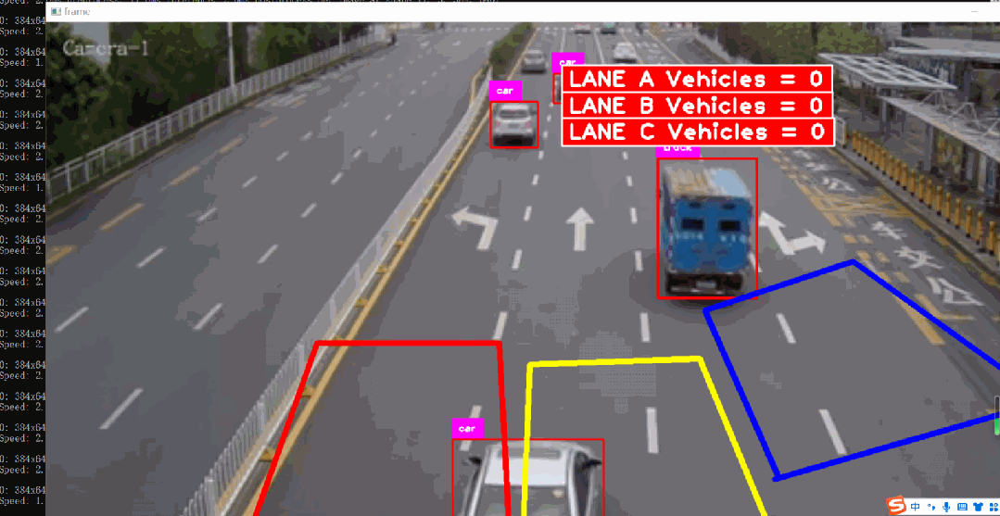

# [Deep Learning] Implementation of a Three-lane Vehicle Counting and Statistical System Based on YOLOv11 in Python Source Code + Model + Demonstration Video

[Official Framework]

https://github.com/ultralytics/ultralytics

[Test Pass Environment]

anaconda3+python3.8

torch==1.9.0+cu111

ultralytics==8.3.3

[Effect Demonstration]

Please note that the effect is caused by the frame rate of the screen recording, which appears to be choppy. However, the actual performance is very fast. The drawing of three areas is only for demonstration purposes. You can achieve this by modifying the code to draw two or more areas.

[Usage Steps]

Step 1: Follow the official installation guide from ultrlytics to set up the environment properly.

Step 2: Switch to the source code directory and execute python main.py to view the effect. If you are using PyCharm, you need to connect the Yolov11 environment to PyCharm and open the project. Right-click on Run main.py to run it.

[Source Code Download]

## Payment

Here is a pay link on Stripe ( https://buy.stripe.com/3cs8yP7sY87d0vu9AB ). Please contact me lonlonago@foxmail.com after funding $89, and I will send you a complete data files , thank you!

